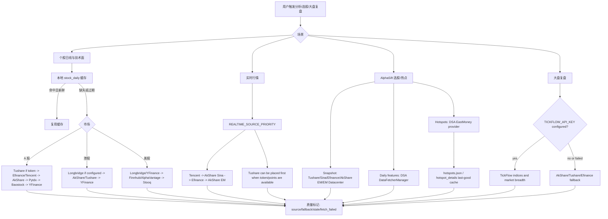
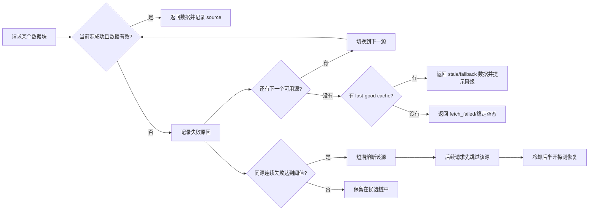
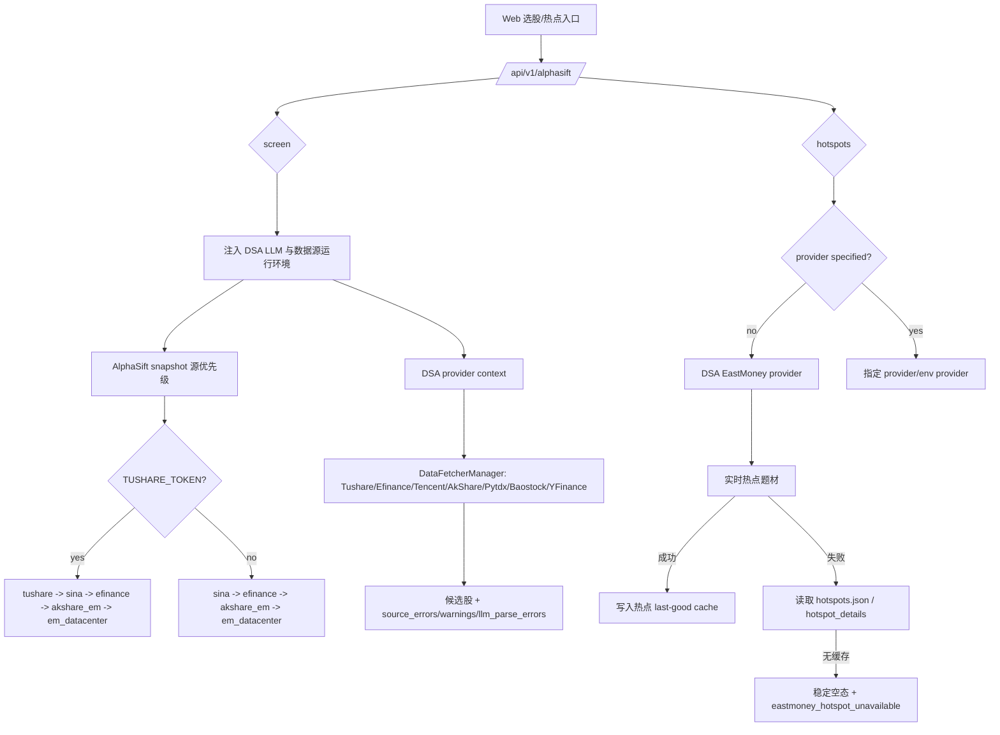

# 数据源稳定性与故障处理图示

本文面向用户、部署者和维护者，说明 DSA 已接入的数据源如何参与分析、选股和大盘复盘，以及当数据源失败时系统会怎么降级。

核心原则：先用项目已经接入并验证过的数据源，把失败路径讲清楚；新增外部数据源应放在第二阶段，避免先扩大维护面。

## 基本面报告期与股票范围

AkShare 的业绩预告、快报是按 `date=YYYYMMDD` 查询的全市场表，机构持股按“年份+季度”查询；适配器依次尝试最近两个已结束季度，并在返回前筛选当前股票。表中没有目标股票或缺少代码列时继续尝试前一期，不会用其他股票的首行，也不会退回接口内置的多年以前默认日期。十大股东查询复用现有沪/深/北代码转换，明确传入带市场前缀的股票和报告期。

机构推荐不代表机构持仓变化，普通股东户数也不代表十大股东持仓变化；这些不同含义的数据不会再作为对应字段的备用来源。业绩报表也不再替代业绩预告。未披露、缺数据或上游解析失败时保留局部数据和错误诊断；`partial` 本身不代表全部取数失败。此修复不改变超时预算、普通日 K 数据源优先级、API/报告字段或用户配置，也不保证上游东财返回结构始终可用。

业绩快报摘要只从实际返回的营收、净利润、同比、每股收益和净资产收益率生成，保留零值与负值；公告日期不作为快报内容。业绩预告按明确的披露文本字段提取，不把日期或变动幅度数值当作摘要。只有日期或指标全部缺失时不生成有效摘要，避免缓存及 Agent 输出把元数据误当作业绩信息。

## 一句话答复用户

如果遇到“数据源失败”，通常不是系统只能用一个源，而是免费源被限流、上游接口临时变更、网络抖动或当前市场/标的不支持。DSA 已经内置多数据源 fallback，会按场景自动尝试下一个源；如果你希望更稳定，建议至少配置一个 token 型稳定源：

- A 股个股与 AlphaSift：优先配置 `TUSHARE_TOKEN`，并保留 AkShare / Efinance / Tencent / Baostock / YFinance 兜底。
- A 股大盘复盘：配置 `TICKFLOW_API_KEY` 后，指数和市场宽度会优先尝试 TickFlow，失败后回退现有免费源。
- 港股 / 美股：配置 `LONGBRIDGE_*` 后优先使用 Longbridge，YFinance、Finnhub、AlphaVantage 继续兜底。
- 热点题材：AlphaSift 热点默认走 DSA EastMoney provider，并使用本地 last-good cache 降低实时接口失败影响。

## 已接入数据源矩阵

| 场景 | 已接入源 | 默认使用方式 | 失败处理 |
| --- | --- | --- | --- |
| A 股日线 / 技术面 | Efinance、Tencent、AkShare、Tushare、Pytdx、Baostock、YFinance | `DataFetcherManager` 按优先级尝试；配置 `TUSHARE_TOKEN` 后 Tushare 自动进入候选源 | 单源失败后尝试下一个源；连续失败会短期熔断该源 |
| A 股实时行情 | Tencent、AkShare Sina、Efinance、AkShare EM、Tushare | `REALTIME_SOURCE_PRIORITY` 控制顺序，默认偏向 Tencent / Sina 这类轻量源 | 失败源记录 `fallback_from`，成功源继续返回 |
| A 股 ETF 实时行情 | Tencent、AkShare Sina、Efinance、AkShare EM | Tencent / Sina 使用单标的独立接口；Efinance / AkShare EM 同属 Eastmoney 物理上游 | 轻量源瞬时错误最多重试 1 次；同一物理上游网络失败后本轮不重复请求 |
| A 股场内 ETF 资金流 | AkShare / 东方财富 | 按沪深代码路由日主力、大单、超大单净额与占比；逐笔有买卖性质时补充盘中主动成交估算 | 日流失败保持 `not_supported/failed` 并让分析主链 fail-open；盘中失败保留日流并标记 limitations |
| A 股大盘复盘 | TickFlow、AkShare、Tushare、Efinance | 配置 `TICKFLOW_API_KEY` 后，主指数和市场宽度优先尝试 TickFlow | TickFlow 权限不足或失败时回退 AkShare / Tushare / Efinance 链路 |
| AlphaSift 选股快照 | Tushare、Sina、Efinance、AkShare EM、EastMoney Datacenter | 有 `TUSHARE_TOKEN` 时自动把 `tushare` 放入快照优先级；否则使用免费源链路 | AlphaSift 维护 source health；DSA 状态接口透出 snapshot/daily health |
| AlphaSift 日线补特征 | DSA `DataFetcherManager` | AlphaSift 调用 DSA provider context，优先复用 DSA 日线与缓存链路 | DSA 链路失败后才回到 AlphaSift 原始日线源 |
| AlphaSift 热点题材 | DSA EastMoney provider、AlphaSift hotspot、last-good cache | 未指定 provider 时默认使用 DSA EastMoney provider | 实时失败时回退热点缓存；无缓存时返回稳定空态和可读错误 |
| 港股 / 美股 | Longbridge、YFinance、AkShare、Tushare、Finnhub、AlphaVantage、Stooq | 配置 Longbridge 凭证后参与港美股日线/实时兜底；YFinance 保持基础兜底 | Longbridge 冷却或失败时回退 YFinance / 其他可用源 |

## 总体链路图



## 失败与降级图



当前日线源熔断策略为连续失败 3 次后短期冷却约 5 分钟。它的目的不是永久禁用数据源，而是避免一个短时间不可用的源拖慢整批分析。

实时行情另有请求级安全边界：腾讯、新浪等轻量单标的源单次最多等待 10 秒，Eastmoney 全量源单次最多等待 8 秒，单只标的整条链路最多等待 20 秒。默认优先级中腾讯位于新浪之前时，腾讯等待 5 秒仍未完成会并行启动新浪；腾讯快速失败、空数据或无有效价格时立即启动新浪。两者的调用锁、遗留线程和限速状态按物理上游隔离，首个有效行情成为主行情，调用返回后的迟到结果不会覆盖 winner 或写入 last-good。所有实时源失败后，仅可使用同一市场交易日、年龄不超过 30 分钟的进程内 last-good 行情，并明确标记为 `stale`；无合格缓存时记录 `fetch_failed`，分析仍使用历史收盘价继续。

## AlphaSift 选股与热点链路



## 推荐配置档

### 免费模式

适合个人试用，依赖免费源自动 fallback。优点是不需要 token；缺点是更容易遇到上游限流或临时接口变化。

```env
REALTIME_SOURCE_PRIORITY=tencent,akshare_sina,efinance,akshare_em
ENABLE_EASTMONEY_PATCH=true
```

### A 股稳定模式

适合经常跑选股、批量分析或对外服务。Tushare 用于增强 A 股日线与快照稳定性；TickFlow 可增强 A 股日 K、实时行情和大盘复盘（实时行情需显式加入 `REALTIME_SOURCE_PRIORITY`）；免费源继续作为兜底。

```env
TUSHARE_TOKEN=your_tushare_token
TICKFLOW_API_KEY=your_tickflow_key

REALTIME_SOURCE_PRIORITY=tickflow,tushare,tencent,akshare_sina,efinance,akshare_em
SNAPSHOT_SOURCE_PRIORITY=tushare,sina,efinance,akshare_em,em_datacenter

# AlphaSift 选股运行期默认值；显式配置时会保留你的值
DAILY_FETCH_RETRIES=3
DAILY_FETCH_MAX_WORKERS=1
```

注意：TickFlow 能力按套餐权限分层；权限不足或请求失败时会 fail-open 回退到现有免费源，不建议把它当成所有市场行情的唯一来源。

### 港股 / 美股稳定模式

适合港美股组合、持仓和个股分析。Longbridge 配置后优先参与港美股链路；YFinance、Finnhub、AlphaVantage 作为兜底。

```env
LONGBRIDGE_OAUTH_CLIENT_ID=your_client_id
LONGBRIDGE_OAUTH_TOKEN_CACHE_B64=your_token_cache_base64

FINNHUB_API_KEY=your_finnhub_key
ALPHAVANTAGE_API_KEY=your_alphavantage_key
```

如果仍使用 Legacy Longbridge 凭证，也可以继续配置：

```env
LONGBRIDGE_APP_KEY=your_app_key
LONGBRIDGE_APP_SECRET=your_app_secret
LONGBRIDGE_ACCESS_TOKEN=your_access_token
```

## 用户可见提示建议

对外沟通时建议区分三类情况：

| 情况 | 建议提示 |
| --- | --- |
| 单个源失败但 fallback 成功 | 本次使用了降级数据源，分析仍可继续；报告中会标记实际成功源。 |
| 多个源失败但有缓存 | 实时源不可用，本次使用同交易日 30 分钟内的 last-good 行情；报告会显示缓存年龄并降低置信度。 |
| 全部源失败且无缓存 | 本次实时行情标记为 `fetch_failed`，分析继续使用历史收盘价；可稍后重试或配置 token 型数据源。 |

## 资金流数据边界

个股资金流通过 AkShare `stock_individual_fund_flow` 显式传入股票代码和沪深北市场，按有效日期选择最新交易日，读取 `主力净流入-净额`（元）。不把净占比、排名、默认股票或其他股票的数据当成目标股票的资金流。当前日线接口不提供 5 日 / 10 日累计金额，这两个字段保持缺失。

行业排名只读取 `stock_sector_fund_flow_rank` 的 `今日主力净流入-净额`，不降级到某个行业的个股明细表。行业金额中的缺失值及正负无穷值被过滤，零值和负值保留；全部金额无效时返回空排名，仍保留已取得的个股金额及来源链。个股源失败时仍可返回行业排名；没有有效日期或有限金额时不标记个股资金流成功。上述边界遵循 [AkShare 官方接口契约](https://akshare.akfamily.xyz/data/stock/stock.html)。本节为中文专题说明，没有对应英文文档。

## 后续可做的产品化增强

1. 数据源 Doctor 页面：展示每个源最近成功时间、失败原因、熔断状态和下一次恢复探测时间。
2. 一键推荐配置：根据市场选择生成 `.env` 片段，例如“A 股稳定模式”“港美股稳定模式”“免费模式”。
3. AlphaSift 状态面板：直接展示 snapshot/daily source health，让用户知道是 Sina、Efinance、AkShare 还是 Tushare 出问题。
4. 批量任务限速策略：对免费源自动降低并发，优先复用本地日线缓存，减少触发上游限流。
5. 可选商业源接入：只有在现有 Tushare / TickFlow / Longbridge / Finnhub / AlphaVantage 仍不能覆盖需求时，再考虑新增 Twelve Data、Massive/Polygon、Nasdaq Data Link 等源。

## 财务摘要表结构

新浪当前还使用 `营业总收入增长率`、`归属母公司净利润增长率`、`净资产收益率(ROE)` 和 `经营现金流量净额`。这些标签与已有规范字段作明确映射，不通过模糊匹配把金额和增长率混用；原有带单位标签继续支持。

AkShare `stock_financial_abstract` 返回“指标行 + 报告期列”的宽表。适配层选取最新有效报告期列，以明确的指标名读取收入、归母净利润、经营现金流、同比增长率、ROE 和毛利率。同比百分比不能填入金额字段；缺失值保持缺失，不跨报告期补值。仅有报告日期或全部指标为空时，不标记财务数据成功。普通行表仍沿用现有解析路径。

指标别名兼容上游带单位的名称，包括 `营业总收入(元)`、`归属净利润(元)`、`营业总收入同比增长(%)`、`归属净利润同比增长(%)`、`经营现金流量净额(元)`、`净资产收益率(加权)(%)` 和 `销售毛利率(%)`；仍按完整名称精确匹配，避免混淆金额、百分比与不同口径的指标。

接口形状参考 [AkShare 官方文档](https://akshare.akfamily.xyz/data/stock/stock.html)。本节为中文专题说明，没有对应英文文档。

## 基本面耗时诊断

基本面调用的 `duration_ms` 表示本次调用实际等待的毫秒数，使用单调时钟计时，包括成功、异常、等待超时和线程池拒绝。它不表示配置的超时预算；线程池已满时通常会快速返回。超时只停止当前等待，不证明后台请求已退出，因此不能单凭耗时是否等于预算判断请求“挂死”。本次诊断修复不改变线程槽位和取消语义。本说明没有对应英文专题文档。

## 基本面超时与后台任务

基本面 fetch 超时只结束本轮等待，Python 线程中的第三方调用仍可能继续运行。每个管理器的 8 个后台槽位只在真实任务结束后释放，不能把“返回 timeout”当作取消成功。

对于 AkShare 财务包、资金流、龙虎榜三个独立操作，首次超时后，只要该操作仍有超时任务在后台运行，当前进程内的后续请求（包括其他股票、重新创建的分析管理器）就会快速返回 `timeout: previous request still running`，不再重复启动相同操作。真实任务成功或异常退出后自动解除保护；若同批并发中已有多个任务超时，需要全部退出。健康调用的并发不变，实时估值、板块多源 fallback 及其他提供方的路径不受此保护键影响。

这是重复请求抑制，不是后台取消或全进程线程上限。保护生效前已经并发进入的请求不会被中止；未接入保护键的操作仍受原来的每管理器槽位限制。某操作永久挂起时，该操作在当前进程中持续降级，其他操作仍可继续；彻底回收永久挂起的第三方调用仍需底层网络 timeout 或单独设计进程隔离，并验证桌面冻结包和跨平台兼容。保护不跨进程共享，不缓存迟到的结果，也不改变既有基本面缓存 TTL。没有新增配置或 API 字段。本节为中文专题说明，没有对应英文文档。

## 官方资料

- Tushare: https://tushare.pro/document/2
- TickFlow: https://tickflow.org/
- AkShare: https://akshare.akfamily.xyz/
- Longbridge OpenAPI: https://open.longportapp.com/
- Finnhub API: https://finnhub.io/docs/api
- Alpha Vantage API: https://www.alphavantage.co/documentation/
